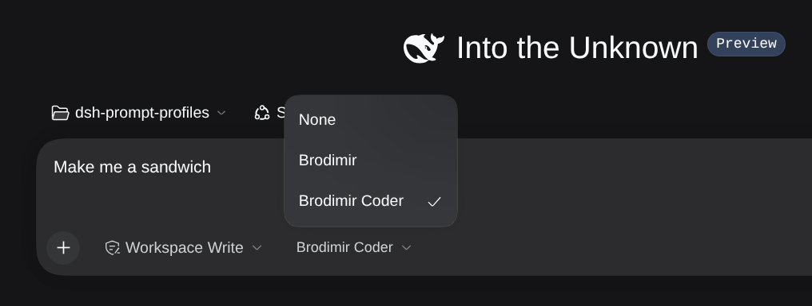
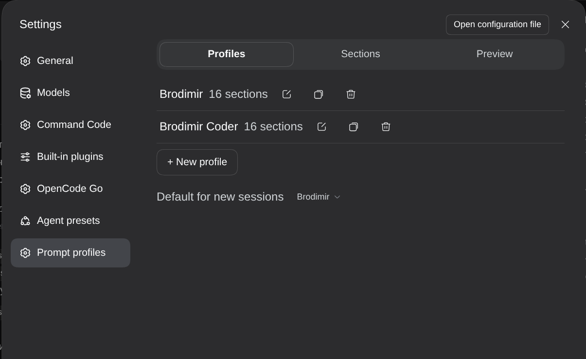
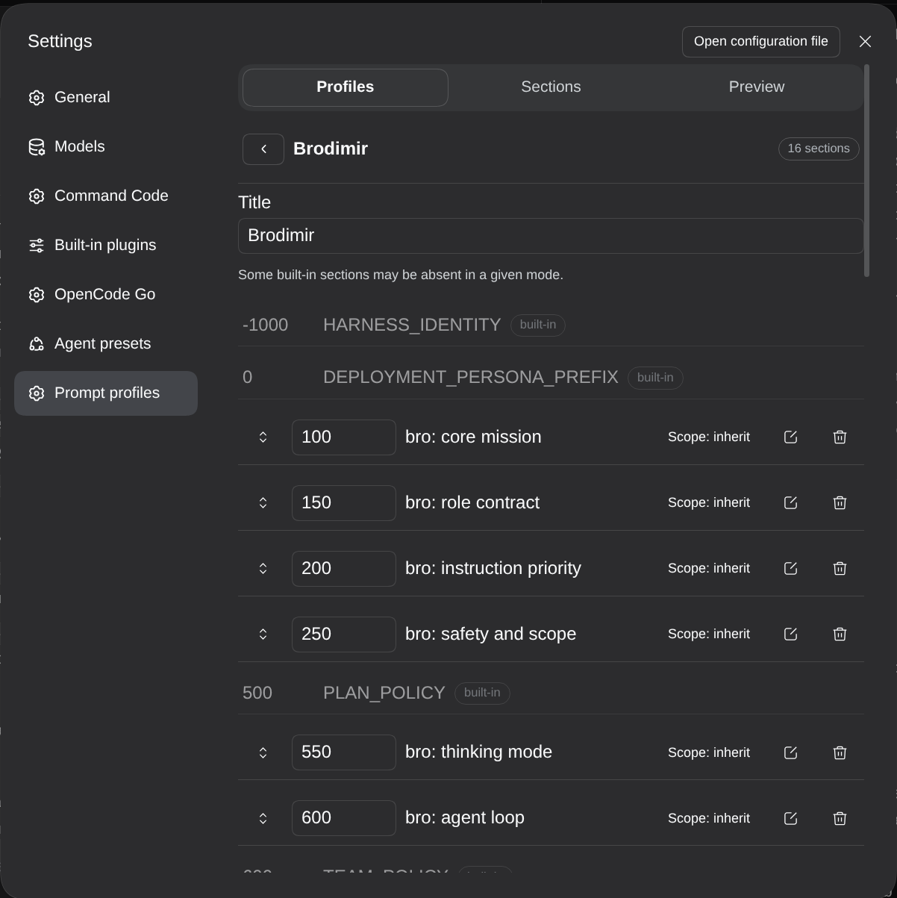
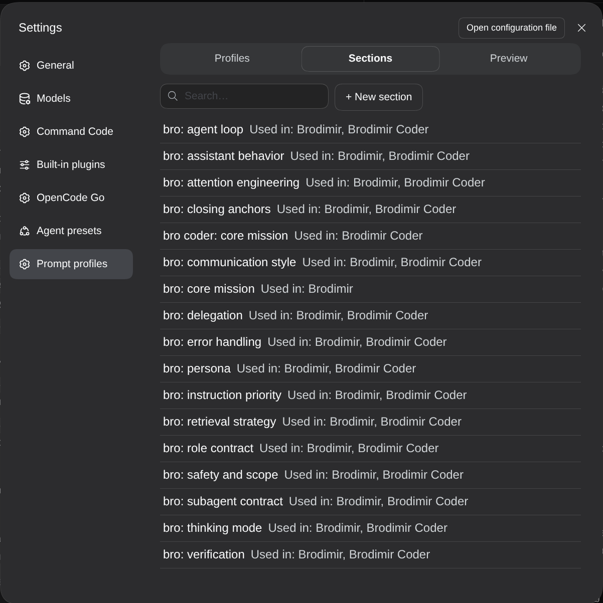
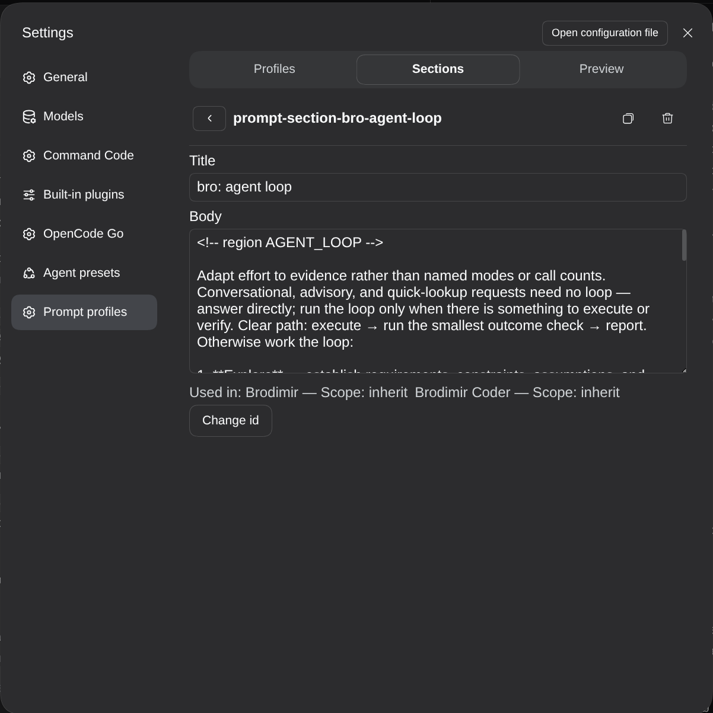

# 📦 @knopki/dsh-prompt-profiles

<div align="center">

<h3>DeepSeek Harness 的按会话提示词配置：把可复用的系统提示词片段组合成多个命名配置，并在会话启动时固化进该会话的提示词</h3>

<p align="center">
  <a href="https://www.npmjs.com/package/@knopki/dsh-prompt-profiles"></a>
  <a href="LICENSE"></a>
  <a href="https://github.com/topics/dsh-plugin"></a>
  <a href="#要求"></a>
</p>

<p align="center">
  <a href="README.md"><b>🇬🇧 English</b></a> •
  <a href="README.ru.md"><b>🇷🇺 Русский</b></a> •
  <a href="README.zh.md"><b>🇨🇳 中文</b></a>
</p>

<table align="center">
  <tr>
    <td align="center">
      🗄️ <strong>仓库已归档。</strong> issue 和 pull request 已随仓库一并关闭。如果仍然需要这个插件，欢迎 fork：MIT 许可，且 <code>lib/</code> 已提交，fork 后无需构建即可安装。
      <br><br>
      ➡️ <strong>想换一个 agent 的语气？</strong> 用带 <code>@deepseek-ai/dsh-persona</code> 的 agent preset。下面的迁移一节就是完整做法。
    </td>
  </tr>
</table>

</div>

---

> **本仓库已归档。** 只读：不再发布新版本，也不再处理 issue。插件在它针对的 DSH 版本上仍然可用，但它解决的问题现在由平台本身覆盖。请先读[为什么归档](#为什么归档)和[如何不用它达成同样效果](#从提示词配置迁移到-agent-preset)。下面的参考文档保留给仍在运行已安装副本的人。

## 为什么归档

**平台长出了同一条轴。** 这个 bundle 在 agent preset 旁边加了一条「agent 被要求怎么工作」的维度。agent preset 后来成了这件事的官方位置：`@deepseek-ai/dsh-agent-preset` 用普通 YAML 声明一个 agent 的子行，`@deepseek-ai/dsh-persona` 拥有 preset 内部的 persona 前缀与后缀槽位。一个语气一个 preset，就做到了一个配置原来做的事，而且走的是平台自己的 loader、提示词注册表和文档，而不是把每个都再实现一遍。

**相比本插件强在哪。** bundle 必须去替换已经组装好的提示词、把固化的会话快照留在 `$DSH_HOME/storages/prompt_profiles/` 下，还要把自己的定义行写进 `cordis.patch.yml`。它还锁了一个 peer 版本窗口（`>=0.1.7-rc.2 <0.2.2-0`），窗口之外需要 `dsh plugin allow-version`，并且为了输入框里的标签和编辑器向客户端注入两个包。preset 组合只声明它挂载的包：没有版本豁免，没有要清理的存储，没有客户端注入，persona 文本和与之配套的工具、权限躺在同一个 YAML 块里，所以「这个 agent 是什么」和「它被要求怎么工作」在同一处阅读和评审。

**没有用户。** npm 计数器显示该包零下载，我唯一知道的安装是我自己的。没人安装的 bundle 在每个 DSH 发布窗口都要付一次重新验证的成本，却什么都不回报。归档是诚实的结论；如果你不同意，fork 只差一个 `git clone`。

## 从提示词配置迁移到 agent preset

映射几乎是机械的：一个配置变成一个 preset，它的各段成为这个 preset 的 persona `prefix`（如果某段本来就该排在官方指引之后而不是之前，那就是 `suffix`），preset 在会话启动时选定，而不是在输入框的标签里选。

### 1. 先盘点手上有什么

配置和分段以行的形式存在你的 profile 组合里（web profile 用 `cordis.patch.yml`，共享安装用 `~/.dsh/cordis.patch.yml`），位于 `prompt-profiles` 这条 insert 行内。删除任何东西之前先把它们抄出来，或者打开 **Settings → Prompt profiles → Preview**：该页签把配置显示在官方分段之间它所在的位置，而这个顺序正是 preset 需要复现的东西。

### 2. 每个配置声明一个 preset

从你的基线 preset（通常是 `standard`）出发，加一行 persona。`persona` 行必须挂在 preset 内部：挂在全局会与提示词注册表自己的 persona 注册冲突并直接报错。这个冲突是设计，不是意外——这一行存在的目的就是替某个 agent 遮蔽部署级 persona。

```yaml
- insert:
    - id: preset-reviewer
      name: '@deepseek-ai/dsh-agent-preset'
      config:
        id: reviewer
        description: Terse reviewer. Reports findings, not opinions.
        order: 10
        plugins:
          - id: persona
            name: '@deepseek-ai/dsh-persona'
            config:
              prefix: |
                You review code by reading the diff first and saying what breaks.
```

`prefix` 必填，`suffix` 默认为空（它不继承全局后缀），两者都是模板：`{{…}}` 分组在渲染时严格对照已注册的提示词变量解析，与本插件 sealer 用的是同一份严格性。还有两个字段值得知道：`complete: true` 只保留前缀作为系统提示词，`minimal` 一类 preset 就是这么做的；`includeRuntimeContext: false` 会为该 agent 去掉可选的 runtime 上下文。

### 3. 还原 `scope` 原来做的事

这是唯一一处映射不机械的地方。配置里的一段可以是 `inherit`、`main-only` 或 `subagents-only`；preset 没有按段的可见范围，它只有一个组合。只面向子 agent 的文本应该放进创建这些子 agent 时所用的 preset，而不是父级的 persona——是否方便取决于你如何派生子 agent。如果两种拆分都不合适，把文本并进父级 persona 是务实的选择：子 agent 只是读到了一条它不会照着做的要求。

### 4. 选 preset 而不是选配置

preset 在会话启动前于平台界面按会话选择，注册表的 `default` 和 `selectedDefault` 决定不做选择时新会话拿到什么。选 `None` 的等价物是 `standard` preset：两者都表示「这个会话使用平台自己的提示词」。已在运行的会话保留创建时的组合，和它们保留固化配置的方式完全一致。

### 5. 卸掉插件和它的遗留物

```bash
dsh plugin --profile web remove @knopki/dsh-prompt-profiles
```

然后重启 DSH，从组合里删掉 `prompt-profiles` 那条 insert 行（writer 写进去的定义随之消失），并删除 `$DSH_HOME/storages/prompt_profiles/`，别让固化快照留在那里。

### 迁移会失去什么

- 编辑器：配置与分段列表、拖拽排序、在官方分段之间的就地预览、搜索、防抖自动保存、三种界面语言。
- 复用：被五个配置引用的分段是同一段文本配五个位置。preset 把自己用到的文本内联；共用的部分得靠 YAML 锚点或复制。
- 输入框里的标签及其按工作区的记忆，包括显式的 `None` 决定。
- 按段的可见范围。

不会失去的是固化。preset 在 agent 创建时固定其组合，不会回填进活着的 agent，所以「开一个新会话才会生效」的行为原样保留。

---



## 概览

`@knopki/dsh-prompt-profiles` 为 DeepSeek Harness 的安装方案增加了第二条轴：代理预设决定这个代理是什么，提示词配置决定它以什么方式工作。同一个代理使用同一套工具时，既可以作为简洁的代码评审者运行，也可以作为遵循项目惯例的专家运行，差别只在于会话启动时选中的那份配置。

一份配置就是一组有序的片段引用。每条引用有自己的位置和作用范围，同一个片段因此可以出现在多份配置的不同位置上。配置在会话启动时选定，固化进这次会话的提示词，之后不再改动。不选配置时，系统提示词完全不变。

编辑器和输入框里的标签都在 Web 界面里，不用手写提示词也能拼出配置。

## 功能

- 片段可复用：写一次，挂到任意多份配置里，每条引用有自己的顺序和作用范围。
- 作用范围按引用设置（继承、仅主代理、仅子代理）：子代理可以看到父会话看不到的指令，同一个片段在另一份配置里又能对所有代理生效。
- 顺序是确定的：片段按配置里的顺序排列，并在平台内置片段之间占据稳定位置。
- 会话内固化：配置在组装提示词时解析，之后不再变化，恢复的会话拿到的还是它启动时的那一份。
- 显式放弃：选「无」和选一份配置一样，都会被固化成决定，而不是留下一个缺失值。
- 不选配置时，提示词的组装完全不受影响。
- 输入框里的配置标签：位于 `permission` 和 `plan` 旁，可为下一个会话选择配置；该选择按工作区保存。
- 跳过是安全的：未知片段、作用范围不符、已停用、内容为空或变量无法解析的片段只是不进提示词，会话不会因此失败。
- 编辑器支持拖放排序和键盘排序，带搜索、「用于」和「来源」信息、按配置预览和防抖自动保存。检测到并发修改时，编辑器会重新加载数据，而不是静默覆盖你的改动。
- 配置以 patch 行的形式存放在 `cordis.patch.yml`，和其余配置一样可以 diff 和评审。
- 没有第二个需要加固的传输通道：Web 客户端只通过平台的 Remote 通道访问主机。
- 界面提供英文、俄文和中文。

## 安装

```bash
dsh plugin --profile web add @knopki/dsh-prompt-profiles
```

从本地仓库或 git 地址安装：

```bash
dsh plugin --profile web add /path/to/dsh-prompt-profiles
```

`lib/` 已随仓库提供构建产物，安装不会触发构建。首次安装可以通过热更新直接生效；替换已安装的副本则需要重启 DSH。

卸载：

```bash
dsh plugin --profile web remove @knopki/dsh-prompt-profiles
```

## 快速开始

1. 打开 **设置 → 提示词配置 → 片段**，新建一个片段：id、标题，以及要写进提示词的内容。
2. 切到 **配置** 标签，新建一份配置并往里添加片段。顺序可以拖动手柄或用方向键调整，作用范围在每一行上选择。
3. 打开一个新的空会话。`permission` 和 `plan` 旁边的配置标签用来给这个新会话选配置；该选择按工作区保存。

已经在跑的会话会保留启动时固化的提示词，所以配置对之后新建的会话生效。

## 输入框里的配置标签

- 只在空会话、且至少存在一份配置时显示。
- 「无」会显式放弃配置，并把这个决定固化下来。
- 选择按工作区记住：同一个工作区的下一个会话会带上同一份配置。
- 在完全替换提示词的模式下（例如 `minimal`，其预设设置了 `config.complete: true`），引擎会丢弃所有提示词片段。标签会用警告标出这一触发条件，此时配置不起作用。

## 编辑器

**设置 → 提示词配置**有三个标签页：配置、片段和预览。

「配置」标签页列出所有配置和各自的片段数量，并设置新会话的默认配置。



打开一份配置后，它的片段按提示词顺序排列，中间夹着平台的内置片段，可以看清自己的文字在组装后的提示词里落在哪。拖动每行的手柄或直接填写顺序数字可以调整位置，作用范围在行上选择，行内图标用来编辑和移除片段。列表中每个配置旁边有复制和删除按钮。



「片段」标签页列出所有片段和用到它们的配置，并可按 id 和标题过滤。



片段有标题和内容，编辑后短暂停顿即自动保存。其他插件包提供的片段只能停用，其 id 不可修改。修改 id 不会重写配置里的引用，返回结果里会列出仍引用旧 id 的配置，需要手动改。



「预览」标签页显示所选配置在内置提示词片段之间的位置，并列出所有被跳过的片段及原因。

## 提示词变量

片段内容里可以写 `{{name}}` 这样的引用，例如 `{{cwd}}`。会话提示词固化时，运行时严格替换这些变量：未知或写错的引用会让该片段不进提示词，而不会产出损坏的提示词。编辑器里的预览刻意宽松，它会把这个片段标为已跳过并给出原因，让你看到运行时究竟会丢掉什么，而不是运行时根本不会生成的那段文字。

## 数据位置

| 数据 | 位置 |
|---|---|
| 片段和配置的定义、逐行覆盖 | 该安装方案在 `cordis.patch.yml` 中的 patch 行，由本插件包的写入器维护 |
| `default` 和 `lastByWorkspace` | `prompt-profiles` 主行的易失性设置 |
| 每个会话的固化快照 | `$DSH_HOME/storages/prompt_profiles/sessions/<sessionId>.json`，每个会话一条记录 |

## 要求

- DSH 位于 `>=0.1.7-rc.2 <0.2.2-0` —— 本包声明的 peer 版本窗口；`0.2.1-alpha.2` 是实际验证过的版本。
- 超出该窗口时 DSH 会停用插件，直到你为它授予精确版本豁免（`dsh plugin allow-version`）。
- 所用安装方案自带的插件：主机端 `settings`、`configEditor`、`workspaceRegistry`、`storageDomain`、`typert` 和 `agentPresets`；Web 端 `@deepseek-ai/dsh-client-ui-settings`、`@deepseek-ai/dsh-client-ui-conversation` 和 `@deepseek-ai/dsh-client-ui-primitives`。
- 缺少可选服务时只影响对应功能，不会挡住插件的挂载。

## 开发

```bash
mise install          # Node、pnpm 以及本包针对的 DSH 版本
pnpm install --store-dir ./.pnpm-store
pnpm run build        # esbuild 打包 + tsc 生成声明到 lib/
pnpm test             # 主机端单元和差分测试（node --test）
pnpm run test:client  # 基于 React + jsdom 的客户端界面（vitest project client）
pnpm run test:remote  # 走真实 gateway 客户端的 Remote 链路（vitest project remote）
pnpm run lint         # biome
pnpm run typecheck    # 对 src 和 test 跑 tsc
pnpm run check        # typecheck + lint + test + test:client + test:remote + build
```

`lib/` 是构建产物，放在仓库里是有意为之：安装时不应当需要构建。产品层面的约定见 [SPEC.md](SPEC.md)，各模块的职责见 [src/](src/) 下的模块契约。

## 已知限制

- 单个 DSH 进程。同一个进程内的写入是协调过的；第二个 DSH 进程编辑同一份 patch 时，可能覆盖行或选择。
- 严格固化。会话的决定只做一次，之后不再修改，空决定也一样。如果某个会话启动时快照记录还不存在，它会保留当时的结果，要给它加配置只能新建会话。

## 许可证

MIT
